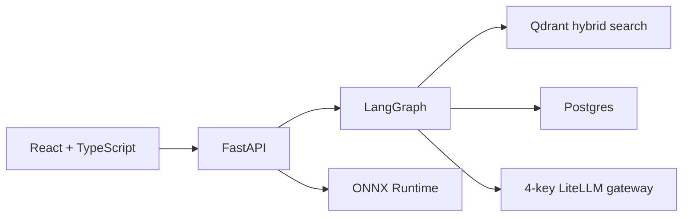

# DaleelAI v2

Evidence-based tax help for Pakistani salaried people, freelancers, and small businesses. Answers are cited to official FBR and SECP text. Tax figures come from a deterministic rules engine, not from a model.

DaleelAI is a final-year project. The approved scope is seven features, all built. The tagged `v1.0` app (Streamlit and Chroma) stays in `src/` as the evaluation baseline. This repository is the v2 system.

This is guidance from official documents, not legal advice. For a filing decision, check the cited section or call FBR at 051-111-772-772.

## Seven features

1. **Agentic RAG chat** in English and Roman Urdu. The router rewrites the question, hybrid search retrieves ordinance chunks, and the answer is verified against those chunks before it is marked verified.
2. **Notice explainer** for a PDF or image. CNIC, NTN, phone, email, and bank numbers are masked in the browser and again on the server. The upload is not stored. The result shows a deadline countdown and can open Find an Expert already filtered to the predicted domain.
3. **Deterministic tax calculator** for TY2026 and TY2027. Salary, freelancer, and property figures come from versioned rule files.
4. **Filer vs non-filer comparison** with a savings bar and a link to the Individual NTN checklist.
5. **Personalized checklists** for NTN, sales tax registration, SECP incorporation, and the income tax return. Progress stays on the device. A checklist can be printed or copied.
6. **Expert finder** backed by a 62 KB int8 ONNX classifier. Listings are public firm pages, not an endorsement.
7. **FBR updates agent** with a saved replay mode. A scrape or crawl that returns nothing leaves the previous rows in place.

## Architecture



| Piece | Choice |
|---|---|
| UI | Vite, React, TypeScript. Chat, calculator, filer, notice, checklists, experts, updates, evaluation. |
| API | FastAPI, Python 3.12, Docker |
| Agents | LangGraph: rewrite, retrieve, rerank, expand, verify |
| Search | Qdrant. Dense `BAAI/bge-small-en-v1.5` plus BM25, fused on the server. Collections: `documents` and `web_pages`. |
| Database | Postgres 16. Parent sections, chats, notifications. |
| Models | LiteLLM. Order: Groq, Gemini on the first key, Gemini on the second key, OpenRouter. |
| Classifier | Word TF-IDF logistic regression, int8 ONNX. Keyword rules if the ONNX file is missing. |

There are no accounts. A session id on the device keeps the chat and checklist progress.

## Evaluation

The question file is 240 synthetic items: 100 English, 100 Roman Urdu, and 40 special cases (unanswerable, provincial, tax-year, prompt injection, evasion refusal). Split: 80 dev, 160 test. File: `backend/eval/datasets/answers.jsonl`.

A read-only sample of 8 test questions, one per gold section, was scored against the live index. The documents collection stayed at 18,600 points. MRR was not scored on this sample, so it is not reported.

| Stage | Recall at 5 |
|---|---|
| v1.0 baseline | not re-run (would replace the live index) |
| dense | 0.625 |
| +headers | not re-run (headers are already in the live chunks) |
| +BM25 hybrid | 0.75 |
| +rerank | not re-run (cross-encoder not loaded) |
| +parent expansion | 0.75 |
| +verification | not re-run (would call an outside model) |
| +web fallback | coverage 1.0, not ordinance recall |

The served classifier is about 62 KB of int8 ONNX plus a small vocabulary file. Macro-F1 on the human-written test set is **0.986**. Human and synthetic scores are stored separately in `backend/ml/reports/classifier_metrics.json`.

Latest local run: **211** backend tests and **39** frontend tests.

## Quick start

Docker Desktop is required. From the repo root:

```powershell
copy .env.example .env
docker compose up -d
```

Put provider keys only in the local `.env`. That file is gitignored. The app is at [http://localhost:5173](http://localhost:5173). The API is at [http://localhost:8000](http://localhost:8000). Health: `GET /health`.

Four saved questions answer immediately when every model provider is down. The first is `Demo: what does section 149 cover?`

Do not delete the Qdrant `documents` collection. Rebuilding it is a separate, explicit job.

## Tests

Backend, inside the running container:

```powershell
docker compose exec -T backend sh -c "ruff check . && ruff format --check . && pytest -q"
```

Frontend, on the host:

```powershell
cd frontend
npm test
npm run typecheck
npm run lint
```

OpenAPI: `contracts/openapi.json`.
