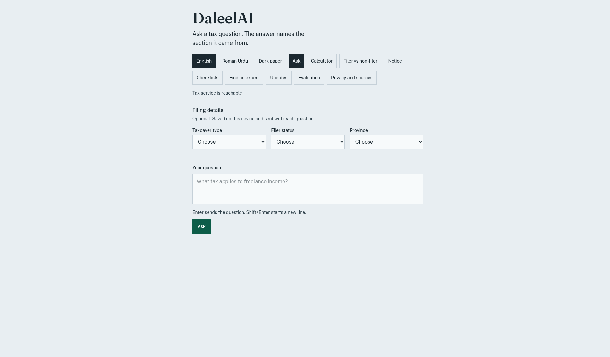
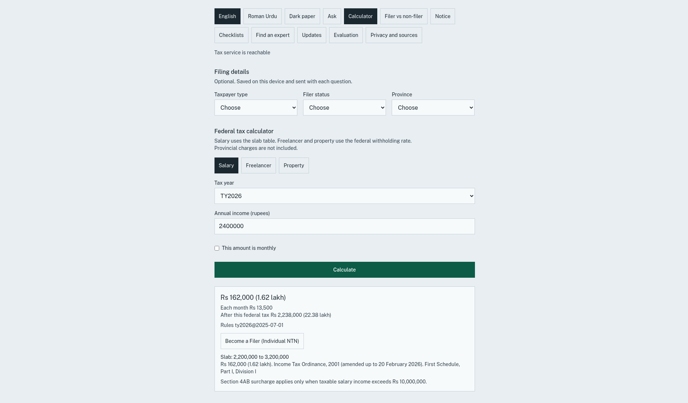
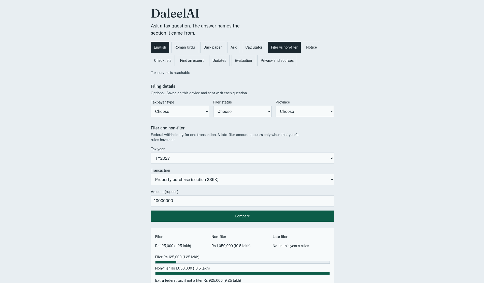
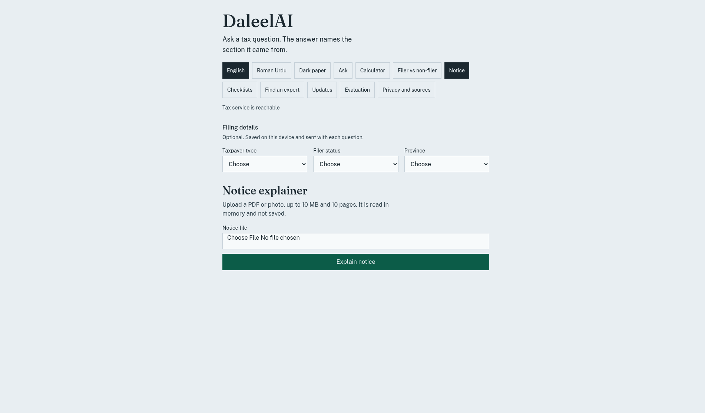
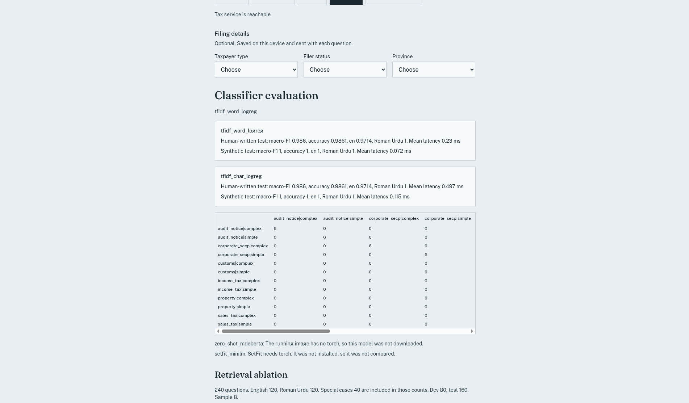
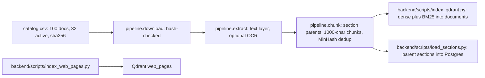
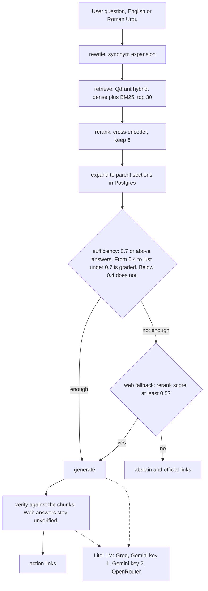

# DaleelAI v2

Evidence-based tax help for Pakistani salaried people, freelancers, and small businesses. Answers are cited to official FBR and SECP text. Tax figures come from a deterministic rules engine, not from a model.

This is guidance from official documents, not legal advice. For a filing decision, check the cited section or call FBR at 051-111-772-772.

## The problem

Pakistani tax law is spread across many versioned PDFs: ordinances, rules, Finance Acts, and circulars. The catalog in `backend/pipeline/catalog.csv` tracks 100 of them, 32 currently active. They are written in legal English, while many users ask in Roman Urdu. A general chatbot can answer confidently from outdated or invented text. DaleelAI answers only from the official documents, cites the section, and refuses when the evidence is too weak.

## Results at a glance

All numbers come from files in this repo.

| What | Result | Source |
|---|---|---|
| Retrieval Recall@5, dense to dense + BM25 hybrid | 0.625 to 0.75, measured on 8 questions | `backend/eval/reports/ablation.json` |
| Mean lookup latency, dense to hybrid | 167 to 90 ms, measured on 8 questions | `backend/eval/reports/ablation.json` |
| Domain classifier macro-F1, human-written test set | 0.986. The export is int8 ONNX, 62,390 bytes (about 62 KB) | `backend/ml/reports/classifier_metrics.json` |
| Indexed points | 18,600 in the Qdrant `documents` collection | `backend/eval/reports/ablation.json` |
| Tests | 211 backend (`pytest --collect-only`), 39 frontend (`vitest run`, 5 files), all passing | counted 2026-10-19 |

The 8-question sample is small. See Limitations.

## Demo

Local screenshots. The header on each one shows the tax service as reachable. There is no hosted demo.



The Ask page before a question is sent. The box is empty and shows the placeholder "What tax applies to freelance income?" Filing details are optional and still on "Choose". English and Roman Urdu are in the header.



Federal tax calculator, salary, tax year TY2026, annual income 2400000. The result is Rs 162,000 (1.62 lakh): Rs 13,500 each month, and Rs 2,238,000 (22.38 lakh) after this federal tax. Rules `ty2026@2025-07-01`. The cited slab is "2,200,000 to 3,200,000" from the Income Tax Ordinance, 2001 (amended up to 20 February 2026), First Schedule, Part I, Division I. The note says the section 4AB surcharge applies only when taxable salary income exceeds Rs 10,000,000. A button links to the Individual NTN checklist.



Filer and non-filer, tax year TY2027, property purchase (section 236K), amount 10000000. Filer Rs 125,000 (1.25 lakh), non-filer Rs 1,050,000 (10.5 lakh), late filer "Not in this year's rules". The bars repeat those two amounts. Extra federal tax if not a filer: Rs 925,000 (9.25 lakh).



Notice explainer before a file is chosen. The page says to upload a PDF or photo, up to 10 MB and 10 pages, read in memory and not saved. The file control says "No file chosen". There is no explanation yet.



Classifier evaluation for `tfidf_word_logreg`. Human-written test: macro-F1 0.986, accuracy 0.9861, English 0.9714, Roman Urdu 1, mean latency 0.23 ms. Synthetic test: macro-F1 1, accuracy 1, mean latency 0.072 ms. The character model is shown beside it, with the same human-written macro-F1 of 0.986. A confusion matrix follows, then the notes that `zero_shot_mdeberta` and `setfit_minilm` were not trained. The retrieval ablation section states 240 questions (120 English, 120 Roman Urdu, 40 special cases included in those counts, 80 dev, 160 test) and a sample of 8. The stage rows sit below this shot.

> **TODO:** shots that need a live index and model keys:
> 1. A chat answer with section citations
> 2. A question in Roman Urdu
> 3. A refusal (insufficient evidence or out of scope)

DaleelAI is a final-year project. Seven features are built. The tagged `v1.0` app (Streamlit and Chroma) stays in `src/` as the evaluation baseline.

## Seven features

1. **Agentic RAG chat** in English and Roman Urdu. The router turns the question into an English search query. Hybrid search retrieves catalog chunks, and the answer is checked against those chunks before it is marked verified. A web answer is not marked verified.
2. **Notice explainer** for a PDF or image (PNG or JPEG). CNIC, NTN, phone, email, and bank numbers are masked in the browser and again on the server. The upload is not written to disk. The result shows a deadline countdown and can open Find an Expert already filtered to the predicted domain.
3. **Deterministic tax calculator** for TY2026 and TY2027. Salary, freelancer, and property figures come from versioned rule files.
4. **Filer vs non-filer comparison** with a savings bar and a link to the Individual NTN checklist.
5. **Personalized checklists** for NTN (individual and AOP or company), sales tax registration, SECP incorporation, and the income tax return. Progress is saved on the device. A checklist can be printed or copied.
6. **Expert finder** backed by the int8 ONNX classifier above. Listings are public firm pages, not an endorsement.
7. **FBR updates agent** with a saved replay mode. A scrape or crawl that returns nothing leaves the previous rows in place.

## Architecture

### Ingestion (offline)



### Query and answer (LangGraph, `backend/app/agents/rag_graph.py`)



| Piece | Choice |
|---|---|
| UI | Vite, React, TypeScript. Chat, calculator, filer, notice, checklists, experts, updates, evaluation, privacy. |
| API | FastAPI, Python 3.12, Docker |
| Agents | LangGraph: rewrite, retrieve, rerank, expand, sufficiency, web fallback, generate, verify, links |
| Search | Qdrant. Dense `BAAI/bge-small-en-v1.5` plus BM25, fused with reciprocal rank fusion. Reranker `Xenova/ms-marco-MiniLM-L-12-v2`. Collections: `documents` and `web_pages`. |
| Database | Postgres 16. Parent sections, chats, notifications. |
| Models | LiteLLM, per role in `backend/config/models.yaml`. Order: Groq, then `gemini-3.8-flash` and `gemini-2.5-flash` on `GEMINI_API_KEY`, the same two models on `GEMINI_API_KEY_2`, then OpenRouter. A model whose key is missing is skipped. |
| Classifier | Word TF-IDF logistic regression, int8 ONNX. Keyword rules if the ONNX file is missing. |

There are no accounts. A session id on the device keeps the chat and checklist progress.

## Design decisions

- **Section-aware chunking.** Chunks follow the law's own headings ("149. Salary.-", PART, SCHEDULE), so a hit maps to a citable section (`backend/pipeline/chunk.py`).
- **Hybrid search.** Dense vectors catch paraphrases. BM25 catches exact section numbers and legal terms.
- **Refuse rather than guess.** The sufficiency gate and the verify step come before anything is shown as verified (`backend/app/core/retrieval/sufficiency.py`, `backend/app/agents/grade.py`).
- **No model arithmetic.** Tax figures come from versioned rule files (`backend/app/core/tax_rules/`).
- **Provider fallback.** Rate limits on free tiers shouldn't take the app down. Four saved demo answers work with no provider.
- **Ports and adapters.** External dependencies have fakes in `backend/app/adapters/fakes.py`, which keeps the tests fast and offline.
- **Privacy.** PII is masked in the browser and on the server. Uploads are not stored.

## From v1 to v2

v1.0 (tag `v1.0`, `src/`) was a Streamlit app: page-level PDF text, 500-character chunks, `all-MiniLM-L6-v2` embeddings in Chroma, and one Groq model (`llama-3.3-70b-versatile`). v2 rebuilt it as FastAPI + React with a versioned document catalog, optional OCR, section-aware chunking, Qdrant hybrid search with reranking, a LangGraph agent with sufficiency and verification steps, a multi-provider fallback chain, and six more features beyond chat.

## Evaluation

The question file has 240 synthetic items: 120 English and 120 Roman Urdu. Those include 40 special cases (8 each: unanswerable, provincial, tax-year, prompt injection, evasion refusal). The split is 80 dev, 160 test. File: `backend/eval/datasets/answers.jsonl`.

A read-only sample of 8 test questions, one per gold section, was scored against the live index. The documents collection stayed at 18,600 points. MRR was not scored on this sample, so it is not reported.

| Stage | Recall at 5 | Mean latency |
|---|---|---|
| v1.0 baseline | not re-run (would replace the live index) | – |
| dense | 0.625 | 167 ms |
| +headers | not re-run (headers are already in the live chunks) | – |
| +BM25 hybrid | 0.75 | 90 ms |
| +rerank | not re-run (cross-encoder not loaded) | – |
| +parent expansion | 0.75 | 90 ms |
| +verification | not re-run (would call an outside model) | – |
| +web fallback | coverage 1.0, not ordinance recall | 44 ms |

Parent expansion in this sample reused the hybrid hits, so the 90 ms is that same hybrid lookup, not a second clock. The numbers are the ones stored in `backend/eval/reports/ablation.json`.

The served classifier is 62,390 bytes of int8 ONNX (about 62 KB) plus a small vocabulary file. Macro-F1 on the human-written test set is **0.986**. Human and synthetic scores are stored separately in `backend/ml/reports/classifier_metrics.json`. The ONNX file itself is gitignored (`backend/models/*.onnx`).

## Quick start

### Option A: Docker (full stack)

Docker is required. From the repo root:

```bash
cp .env.example .env          # PowerShell: copy .env.example .env
docker compose up -d
```

Put provider keys only in the local `.env` (`GROQ_API_KEY`, `GEMINI_API_KEY`, `GEMINI_API_KEY_2`, `OPENROUTER_API_KEY`). That file is gitignored. A model whose key is missing is skipped. `.env.example` also lists `ZAI_API_KEY`. The adapter knows that name, and the shipped role list in `backend/config/models.yaml` does not call a Zai model. The app is at http://localhost:5173 and the API at http://localhost:8000. Health: `GET /health`.

### Option B: without Docker (UI, API, calculator, demo answers)

Verified on Linux with `uv` and Node 20:

```bash
cd backend && uv sync --frozen
uv run uvicorn app.main:app --host 0.0.0.0 --port 8000
# second terminal
cd frontend && npm ci
VITE_API_URL=http://localhost:8000 npm run dev -- --host 0.0.0.0 --port 5173
```

Without Qdrant and an index, the health check, calculators, and saved demo answers work. A real chat question returns `qa_failed` with "Search failed before an answer could be written."

### Building the index on a fresh clone

A fresh clone has an empty Qdrant. The backend container's working directory is the `backend/` tree, so `scripts/...` below is `backend/scripts/...` in the repo. Run these with the stack up (the commands come from each script's docstring):

```bash
docker compose run --rm --no-deps backend python -m pipeline.download    # hash-checked PDFs from catalog.csv
docker compose run --rm --no-deps backend python -m pipeline.extract     # text layer; add --ocr for scanned pages
docker compose run --rm --no-deps backend python -m pipeline.chunk       # optional: --doc DOC_ID
docker compose exec -T backend python scripts/index_qdrant.py            # dense + BM25 into "documents"
docker compose exec -T backend python scripts/load_sections.py           # parent sections into Postgres
docker compose run --rm --no-deps backend python scripts/index_web_pages.py   # optional: "web_pages"
```

These index steps have not been verified end to end in a clean environment. Please open an issue if a step fails.

Four saved questions answer immediately when every model provider is down. The first is `Demo: what does section 149 cover?`

Do not delete the Qdrant `documents` collection on a working install. Rebuilding it is a separate, explicit job.

## Tests

```bash
# backend (in the container, or natively with: cd backend && uv run pytest -q)
docker compose exec -T backend sh -c "ruff check . && ruff format --check . && pytest -q"
# frontend
cd frontend && npm test && npm run typecheck && npm run lint
```

Counted on 2026-10-19: `pytest --collect-only` collects 211 tests (211 passed). `vitest run` runs 39 tests in 5 files (39 passed).

OpenAPI: `contracts/openapi.json`.

## Limitations

- The retrieval numbers come from only 8 questions. The v1 baseline, header-free index, rerank, and verification stages were not re-run.
- All 240 eval questions are synthetic. No answer-level faithfulness score yet.
- There is no hosted demo. Live answers need at least one provider key and a built index.
- Guidance only, not legal advice.

## Roadmap

- Run the full 160-question test split across every ablation stage, including the v1 baseline.
- Add answer-level faithfulness and citation-accuracy scoring.
- Add human-written evaluation questions.
- A single documented command for the index build.
